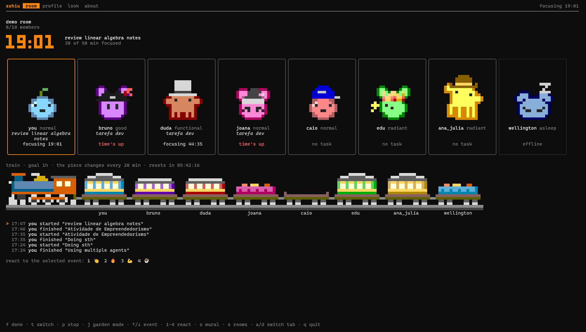
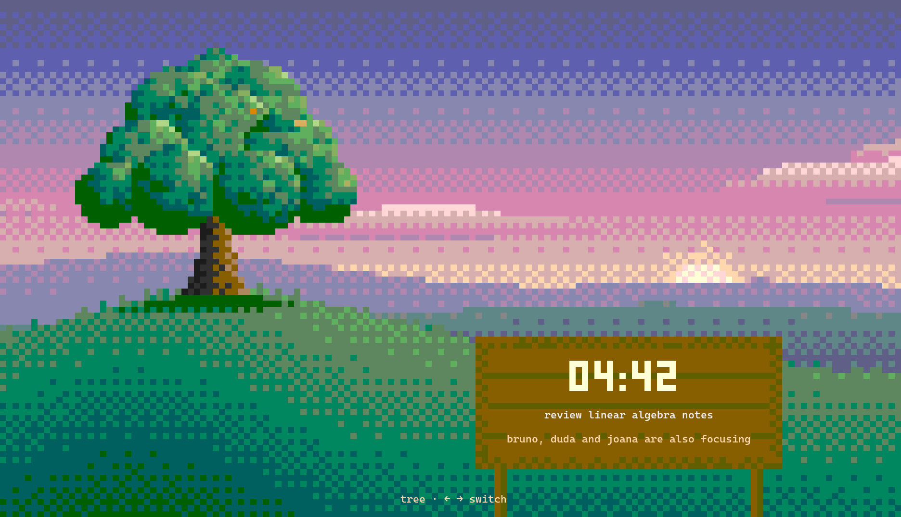
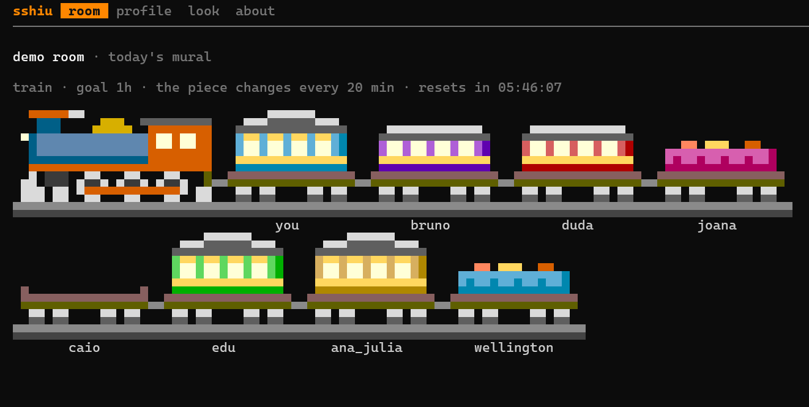
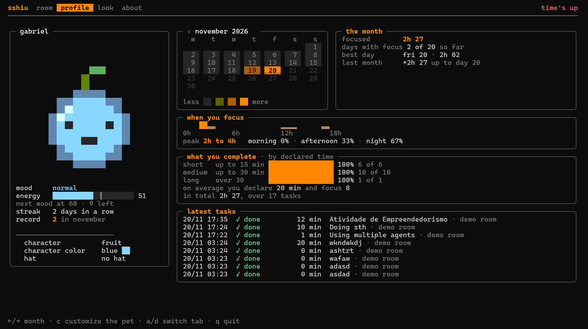
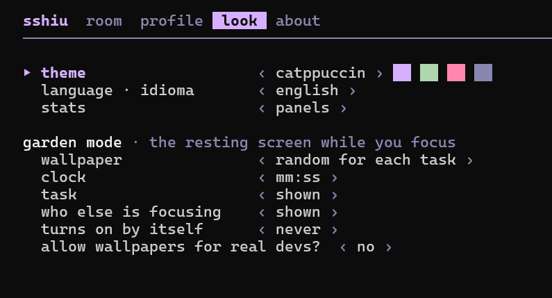
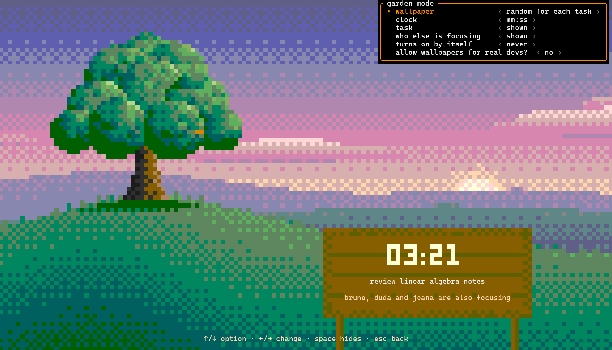

<div align="center">

# sshiu

**a quiet focus room in your terminal, over ssh.**

[pitch deck and trailer](https://drbarros2004.github.io/sshiu/)



</div>

a focus app for a study group, living in the terminal. you say the next concrete thing you're going to do and for how long, you focus, and you mark it done when you finish. your room sees who's focusing and on what, and reacts. your pet's mood reflects your focus.

## screens

**room:** your focus on top, one card per member (pet, mood, task, status and the reactions they got) and the room's events below, with reactions.

**pets:** choose a pet from the available characters, each with its own colors. add a hat and choose its model. press `c` in your profile to customize your pet and preview its moods without changing its actual mood or energy.

**garden mode:** the rest screen while you focus. press `j`, or let it turn on by itself after 30 s without a keystroke. a calm animated wallpaper (a tree at sunset, a night road, a coffee by the window, rain, a lava lamp...) with the time left, your task and who else is focusing on top. `←/→` switches the wallpaper.



<table>
  <tr>
    <td width="50%"><b>mural:</b> what the room builds together today, one piece per member that grows as each one focuses. press <code>o</code> in the room.</td>
    <td width="50%"><b>profile:</b> your pet's character, color and hat, energy, streak, a month of focus and your latest tasks.</td>
  </tr>
  <tr>
    <td></td>
    <td></td>
  </tr>
  <tr>
    <td width="50%"><b>look:</b> the theme, the language (english or português) and what shows up in garden mode.</td>
    <td width="50%"><b>garden editor:</b> <code>v</code> in the look tab changes the same options over the garden itself.</td>
  </tr>
  <tr>
    <td></td>
    <td></td>
  </tr>
</table>

## run it

you need go 1.27 or newer and an ssh client.

1. **create your ssh key**, if you don't have one yet. it's your login:
   ```bash
   ssh-keygen -t ed25519
   ```
   you can just hit enter on every question.

2. **start the server** from the repo root:
   ```bash
   go run . -demo
   ```
   with `-demo` you get a demo room full of bots, and you can pick 1-minute tasks. on the first run, the server creates its own key in `.ssh/` and the `sshiu.db` database.

3. **connect** from another terminal:
   ```bash
   ssh -p 23234 localhost
   ```
   on the first connection, ssh asks whether you trust the server: answer `yes`. then pick a nickname and create a room, join one with a friend's room code, or open the demo room.

   the room code can also go in the command, and you land straight in the room. the `-t` is required: without it, ssh doesn't open a terminal when there's something after the address.
   ```bash
   ssh -t -p 23234 localhost 49ae4z
   ```

to use another port, pass `-port`. to run the tests, use `go test ./...`.

**dev mode**, to test with many people: `go run . -dev -port 23235`. it uses its own `sshiu-dev.db`, listens only on localhost, and who you are comes from the ssh user name instead of the key (`ssh -p 23235 ana@localhost`, `ssh -p 23235 bia@localhost`). the extra dev tab lists everyone and changes energy, idle days, focused minutes, streak, pet color, who's online and the task in progress, and puts people in the room you're looking at.

## open it to your group

by default the server only accepts connections from the same machine. to let other people in:

1. **listen on every interface:**
   ```bash
   go run . -host 0.0.0.0
   ```
   the log prints the join command for each address of this machine, like `ssh -p 23234 192.168.0.33`. the room invite uses the same address, with `-t` and the room code at the end.

2. **open the port in the windows firewall**, in a powershell running as administrator:
   ```powershell
   New-NetFirewallRule -DisplayName "sshiu" -Direction Inbound -Protocol TCP -LocalPort 23234 -Action Allow -Profile Private
   ```
   check which profile you're on with `Get-NetConnectionProfile`: on a **public** network windows refuses incoming connections, so either the rule goes with `-Profile Public` or the network becomes private.

3. **everyone on the same network.** from outside it, the router won't let anyone through without port forwarding, and some guest wi-fi networks isolate devices from each other.

<details>
<summary><b>keep the <code>.ssh/</code> folder</b> (or everyone gets <code>REMOTE HOST IDENTIFICATION HAS CHANGED</code>)</summary>

<br>

the server's key is born there on the first run, and it's the key every ssh client remembers. if it changes (folder deleted, server recreated, another machine on the same address), everyone gets `REMOTE HOST IDENTIFICATION HAS CHANGED` and can only get in after deleting the old key:

```bash
ssh-keygen -R "[192.168.0.33]:23234"
```

outside port 22, the address goes in brackets with the port at the end: that's how it's stored in `known_hosts`, and without the brackets the command finds nothing to delete. on the default port, `ssh-keygen -R 192.168.0.33` is enough. same goes for anyone testing on `localhost`:

```bash
ssh-keygen -R "[localhost]:23234"
```

</details>

## more

the internal docs are in portuguese, for now.

- [`IDEIAS.md`](IDEIAS.md): the backlog and the known tech debt.
- [`CONTEXT.md`](CONTEXT.md): the app's vocabulary.
- [`docs/adr/`](docs/adr/): the architecture decisions and the why behind each one.
- [`docs/regras.md`](docs/regras.md): the numeric rules, with links to the code.
- [`CREDITS.md`](CREDITS.md): where third-party art comes from.
- [`AGENTS.md`](AGENTS.md): instructions for coding agents.
