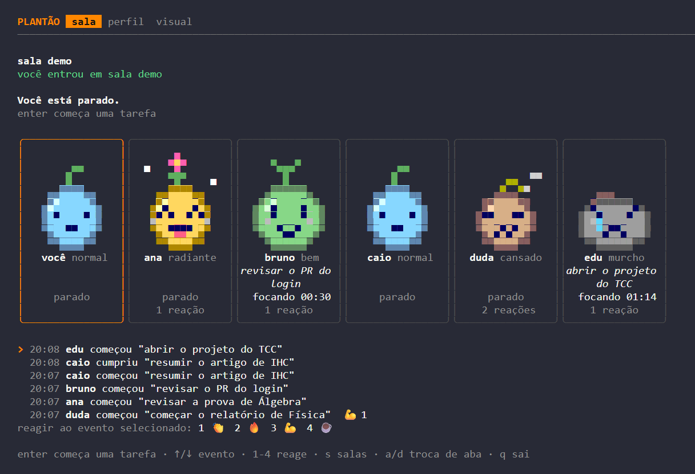
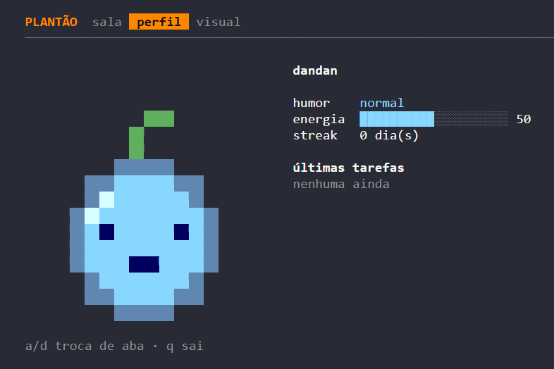

# Plantão

> Nome provisório (WIP): o nome oficial ainda vai ser decidido com o grupo.

Um app de foco que roda no terminal, por SSH, para uma turma estudar junto. Você diz a próxima coisa concreta que vai fazer e por quanto tempo, foca, e marca "feito" quando terminar. A sua sala vê quem está focando e em quê, e reage. O seu pet floresce quando você foca e murcha quando você some.

## Telas

**Sala:** o seu foco em cima, um card por membro (pet, humor, tarefa, status e reações recebidas) e os eventos da sala embaixo, com as reações.



**Modo jardim:** a tela de descanso durante o foco, que liga com `j` ou depois de 30 s sem tecla. Um wallpaper animado e calmo, com o tempo restante, a tarefa e quem mais está focando por cima.


**Perfil:** o seu pet, a energia, o streak e as últimas tarefas.



**Visual:** o tema e o que aparece no modo jardim, a tela de descanso durante o foco.


## Rodar

Precisa de Go 1.27 ou mais novo e de um cliente SSH.

1. **Crie a sua chave SSH**, se ainda não tiver uma. Ela é o seu login:
   ```bash
   ssh-keygen -t ed25519
   ```
   Pode apertar enter em todas as perguntas.

2. **Suba o servidor** na raiz do repositório:
   ```bash
   go run . -demo
   ```
   Com `-demo`, aparece uma sala demo com bots e dá para escolher tarefas de 1 minuto. Na primeira vez, o servidor cria a própria chave em `.ssh/` e o banco `plantao.db`.

3. **Conecte** em outro terminal:
   ```bash
   ssh -p 23234 localhost
   ```
   Na primeira conexão, o SSH pergunta se você confia no servidor: responda `yes`. Depois escolha um apelido e crie uma sala, entre numa com o código de um colega ou abra a sala demo.

   O código da sala também pode vir no comando, e aí você entra direto nela:
   ```bash
   ssh -p 23234 localhost 49ae4z
   ```

Para usar outra porta, passe `-port`. Para rodar os testes, use `go test ./...`.

## Mais

- [`IDEIAS.md`](IDEIAS.md): o backlog e a dívida técnica conhecida.
- [`CONTEXT.md`](CONTEXT.md): o vocabulário do app.
- [`docs/adr/`](docs/adr/): as decisões de arquitetura e o porquê de cada uma.
- [`docs/regras.md`](docs/regras.md): as regras numéricas, com links para o código.
- [`CREDITS.md`](CREDITS.md): de onde vem a arte de terceiros.
- [`AGENTS.md`](AGENTS.md): instruções para agentes de código.
