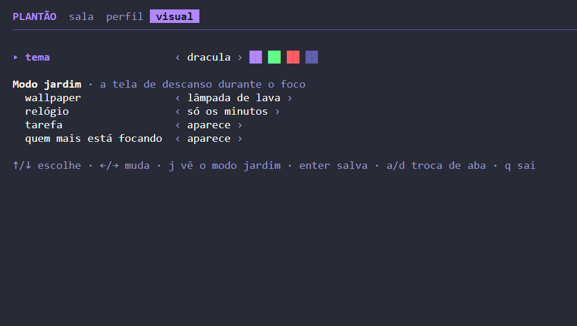

# sshiu

Um app de foco que roda no terminal, por SSH, para uma turma estudar junto. Você diz a próxima coisa concreta que vai fazer e por quanto tempo, foca, e marca "feito" quando terminar. A sua sala vê quem está focando e em quê, e reage. O seu pet floresce quando você foca e murcha quando você some.

## Telas

**Sala:** o seu foco em cima, um card por membro (pet, humor, tarefa, status e reações recebidas) e os eventos da sala embaixo, com as reações.


**Modo jardim:** a tela de descanso durante o foco, que liga com `j` ou, se você deixar, depois de 30 s sem tecla. Um wallpaper animado e calmo, com o tempo restante, a tarefa e quem mais está focando por cima.


**Perfil:** o seu pet, a energia, o streak e as últimas tarefas.


**Visual:** o tema e o que aparece no modo jardim, a tela de descanso durante o foco.



## Rodar

Precisa de Go 1.27 ou mais novo e de um cliente SSH.

1. **Crie a sua chave SSH**, se ainda não tiver uma. Ela é o seu login:
   ```bash
   ssh-keygen -t ed25519
   ```
   Pode apertar enter em todas as perguntas.

2. **Suba o servidor** na raiz do repositório:
   ```bash
   go run . -demo
   ```
   Com `-demo`, aparece uma sala demo com bots e dá para escolher tarefas de 1 minuto. Na primeira vez, o servidor cria a própria chave em `.ssh/` e o banco `sshiu.db`.

3. **Conecte** em outro terminal:
   ```bash
   ssh -p 23234 localhost
   ```
   Na primeira conexão, o SSH pergunta se você confia no servidor: responda `yes`. Depois escolha um apelido e crie uma sala, entre numa com o código de um colega ou abra a sala demo.

   O código da sala também pode vir no comando, e aí você entra direto nela. O `-t` é obrigatório: sem ele, o SSH não abre o terminal quando o comando tem algo depois do endereço.
   ```bash
   ssh -t -p 23234 localhost 49ae4z
   ```

Para usar outra porta, passe `-port`. Para rodar os testes, use `go test ./...`.

## Abrir para a turma

Por padrão o servidor só aceita quem está na própria máquina. Para outras pessoas entrarem:

1. **Suba escutando em todas as interfaces:**
   ```bash
   go run . -host 0.0.0.0
   ```
   O log mostra o comando de entrada com cada endereço desta máquina — por exemplo `ssh -p 23234 192.168.0.33`. O convite da sala usa o mesmo endereço, com `-t` e o código da sala no fim.

2. **Libere a porta no firewall do Windows**, num PowerShell como administrador:
   ```powershell
   New-NetFirewallRule -DisplayName "sshiu" -Direction Inbound -Protocol TCP -LocalPort 23234 -Action Allow -Profile Private
   ```
   Veja em que perfil você está com `Get-NetConnectionProfile`: numa rede **pública** o Windows recusa conexões de entrada, então ou a regra vai com `-Profile Public`, ou a rede passa a privada.

3. **Todo mundo na mesma rede.** De fora dela o roteador não deixa passar sem redirecionamento de porta, e alguns Wi-Fi de visitante isolam os aparelhos entre si.

**Guarde a pasta `.ssh/`:** a chave do servidor nasce lá na primeira execução, e é ela que o cliente SSH memoriza. Se a chave mudar — pasta apagada, servidor recriado, outra máquina no mesmo endereço — todo mundo recebe `REMOTE HOST IDENTIFICATION HAS CHANGED` e só entra depois de apagar a chave antiga:

```bash
ssh-keygen -R "[192.168.0.33]:23234"
```

Fora da porta 22, o endereço fica entre colchetes com a porta no fim: é assim que ele está gravado no `known_hosts`, e sem os colchetes o comando não acha nada para apagar. Na porta padrão basta `ssh-keygen -R 192.168.0.33`. Vale o mesmo para quem testa em `localhost`:

```bash
ssh-keygen -R "[localhost]:23234"
```

## Mais

- [`IDEIAS.md`](IDEIAS.md): o backlog e a dívida técnica conhecida.
- [`CONTEXT.md`](CONTEXT.md): o vocabulário do app.
- [`docs/adr/`](docs/adr/): as decisões de arquitetura e o porquê de cada uma.
- [`docs/regras.md`](docs/regras.md): as regras numéricas, com links para o código.
- [`CREDITS.md`](CREDITS.md): de onde vem a arte de terceiros.
- [`AGENTS.md`](AGENTS.md): instruções para agentes de código.
